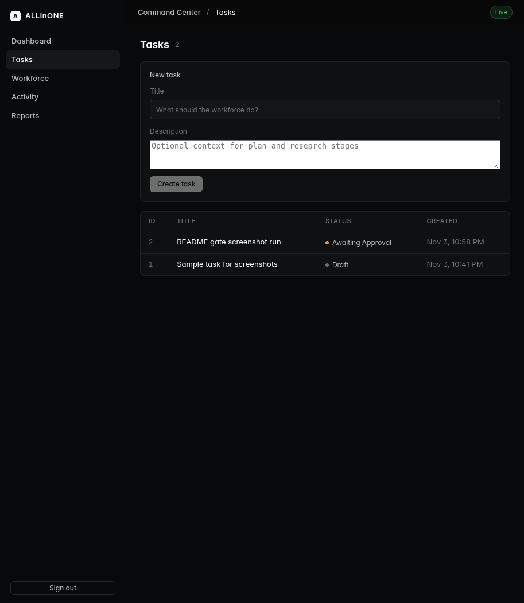
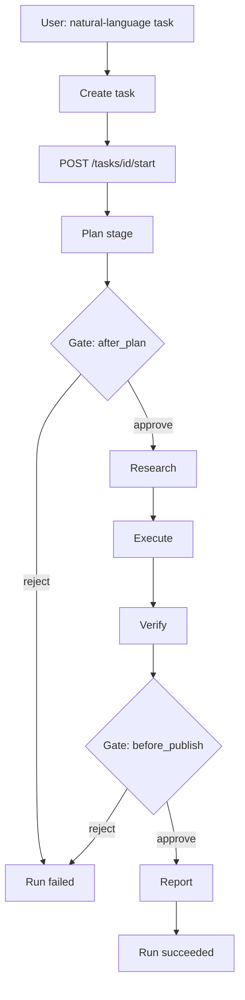
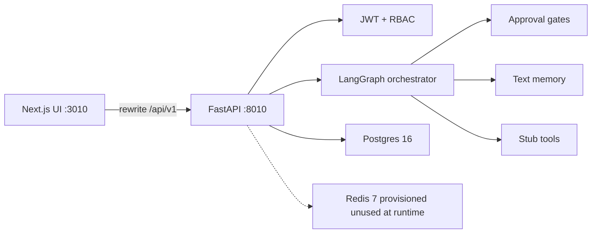

# ALLinONE

[](IMPLEMENTATION_STATUS.md)
[](#technology-stack)
[](#how-it-works)
[](#technology-stack)

<p align="center">
  
</p>

**ALLinONE** is a Command Center for an autonomous digital workforce. You describe a business objective in plain language. The platform creates a task, runs a multi-stage agent workflow (plan → research → execute → verify → report), pauses for human approval at hard gates, and keeps an audit trail.

This repository is a **runnable local MVP**. Stage text is produced by a **deterministic template path** (see [ADR-001](docs/adr/001.md)). Outbound tools and integrations are **stubs**. That is intentional for a credential-safe demo: you can exercise the product loop without paid model keys or live browser automation.

> Product UI branding is **ALLinONE**. Many environment variables, Compose service names, and seed emails still use the historical `GODMODE_*` / `godmode` prefix. That is intentional compatibility, not a second product name.

## Contents

- [What you get](#what-you-get)
- [Screenshots](#screenshots)
- [How it works](#how-it-works)
- [Human-in-the-loop](#human-in-the-loop)
- [System architecture](#system-architecture)
- [Technology stack](#technology-stack)
- [Quick start](#quick-start)
- [Environment](#environment)
- [Demo credentials](#demo-credentials)
- [Example walkthrough](#example-walkthrough)
- [API surface](#api-surface)
- [Tests](#tests)
- [Repository layout](#repository-layout)
- [Implementation status](#implementation-status)
- [Known limitations](#known-limitations)
- [Roadmap](#roadmap)
- [Architecture decisions](#architecture-decisions)
- [Contributing](#contributing)
- [License](#license)

## What you get

| Capability | MVP reality |
| --- | --- |
| Command Center UI | Next.js app: dashboard, tasks, workforce, activity, reports, Live/Fixture source chip |
| Natural-language tasks | Create task + start run; no task update/delete API yet |
| Multi-stage orchestration | LangGraph graph with stages plan → research → execute → verify → report |
| Human gates | Hard stops after plan and before publish; approve resumes, reject fails the run |
| Auth and roles | JWT access + refresh; roles `admin` / `operator` / `viewer` with permission checks |
| Workforce | Five seeded agent definitions (planner, researcher, executor, verifier, reporter) |
| Audit | Write-path audit log + dashboard recent entries |
| Memory | Text memory rows per stage (no embeddings) |
| Reports / analytics | Dashboard summary counts; report list/get/publish |
| Integrations | Authenticated `GET /integrations` returns `[]`; tool and webhook helpers are stubs |

## Screenshots

Captured from the live local stack (ALLinONE branding, Live chip).

| Login | Dashboard |
| --- | --- |
|  |  |

| Tasks | Workforce |
| --- | --- |
|  |  |

| Task detail | Live tasks (alternate) |
| --- | --- |
|  |  |

## How it works



1. Operator creates a task (title + optional description).
2. `POST /tasks/{id}/start` runs the orchestrator **synchronously inside the HTTP request** until the next gate or terminal state.
3. Each stage writes an artifact (markdown), a stage event, and a memory row. The report stage also writes a `Report`.
4. Gates create a pending `Approval`. `POST /approvals/{id}/decide` resumes or fails the run.
5. Resume continues from `run.current_stage` in Postgres (no LangGraph checkpointer).

**Honest detail:** even when `GODMODE_MOCK_LLM=0`, stage bodies still come from the template helper in `apps/api/app/orchestrator.py`. There is **no provider SDK call** in this MVP. The flag mainly surfaces on `/ready` and the run metadata.

Research/execute call **stub tools** (`http_fetch`, `browser_stub`) that return deterministic fake payloads and never open a real browser or network fetch for business data ([ADR-008](docs/adr/008.md)).

## Human-in-the-loop

Two hard gates are product invariants ([ADR-003](docs/adr/003.md)):

| Gate | When | On approve | On reject |
| --- | --- | --- | --- |
| `after_plan` | After plan artifact | Continue research → execute → verify | Run `failed` |
| `before_publish` | After verify | Continue report → succeed | Run `failed` |

Run statuses used in the MVP: `queued`, `running`, `awaiting_approval`, `succeeded`, `failed`, `cancelled`.

Role permissions (simplified):

| Role | read | write | approve | admin |
| --- | --- | --- | --- | --- |
| viewer | yes | | | |
| operator | yes | yes | yes | |
| admin | yes | yes | yes | yes (e.g. disable agent) |

## System architecture



| Concern | Implementation note |
| --- | --- |
| UI → API | Browser calls `/api/v1/*`. Next.js rewrites to `API_PROXY_TARGET` (build-time). Direct `NEXT_PUBLIC_API_URL` is also supported. |
| Persistence | Postgres in Compose; SQLite for `dev-local` / pytest smoke. Schema via SQLAlchemy `create_all` on startup. SQL under `infra/migrations/` is reference only. |
| Redis | Started in Compose for future locks/queues ([ADR-002](docs/adr/002.md)). **Not used by runtime request paths today.** |
| Fixture mode | If the API is unreachable or returns 5xx, the UI can fall back to local fixture data and show a Fixture chip. Prefer Live for demos when the API is healthy. |

Deeper contracts: [docs/ARCHITECTURE.md](docs/ARCHITECTURE.md). Ops notes: [RUNBOOK.md](RUNBOOK.md).

## Technology stack

| Layer | Choice |
| --- | --- |
| Web | Next.js 14.2 (App Router), React 18.3, TypeScript, Motion 11 |
| API | FastAPI 0.115, SQLAlchemy 2, Pydantic, PyJWT, bcrypt |
| Orchestration | LangGraph multi-stage graph with two approval gates |
| Data | PostgreSQL 16 + Redis 7 (Compose); SQLite for local smoke/tests |
| Auth | JWT access + refresh; DB role is source of truth on refresh ([ADR-004](docs/adr/004.md)) |
| Runtime | Docker Compose; optional host-network override for iptables-less hosts |

## Quick start

### Docker (recommended)

```bash
cp .env.example .env
# Set JWT_SECRET to at least 32 characters, e.g. openssl rand -hex 32
# Set POSTGRES_PASSWORD (Compose requires it)
docker compose up --build -d
```

| Service | URL |
| --- | --- |
| Web | http://localhost:3010 |
| API OpenAPI | http://localhost:8010/docs |
| Health | `GET http://localhost:8010/health` |
| Ready | `GET http://localhost:8010/ready` |

#### Hosts without iptables / bridge DNS

If dockerd runs with `--iptables=false`, use the host-network override (ports stay 8010 / 3010):

```bash
docker compose -f docker-compose.yml -f docker-compose.box.yml up --build -d
```

Build the web image with a reachable proxy target on host-network setups:

```bash
API_PROXY_TARGET=http://127.0.0.1:8010/api/v1 \
  docker compose -f docker-compose.yml -f docker-compose.box.yml up --build -d
```

**Stock bridge Compose is unverified** on hosts missing iptables. Do not treat it as proven E2E on this MVP board.

### Without Docker

Python 3.12+ and Node 20+:

```bash
./scripts/dev-local.sh
```

Starts API on `:8010` (SQLite + mock flag) and web on `:3010`.

### Smoke check

```bash
scripts/smoke-local.sh
```

Reuses an API already listening on `:8010`, otherwise starts one. Checks health, ready, login, and dashboard summary. Against Compose, set `SMOKE_PASSWORD` to match your admin password in `.env`.

## Environment

Copy [.env.example](.env.example). Important variables:

| Variable | Purpose |
| --- | --- |
| `JWT_SECRET` | HS256 secret; use 32+ characters outside throwaway local runs |
| `POSTGRES_PASSWORD` / `DATABASE_URL` | Compose DB credentials / connection string |
| `REDIS_URL` | Provisioned; unused by request handlers today |
| `GODMODE_MOCK_LLM` | `1` (default) marks mock mode on `/ready` and runs |
| `GODMODE_ADMIN_EMAIL` / `GODMODE_ADMIN_PASSWORD` | Seed admin (preferred). `SEED_ADMIN_*` is a one-release alias |
| `GODMODE_ENV` | `development` / `production` hardening switch |
| `GODMODE_REQUIRE_JWT_SECRET` | When `1`, `/ready` returns 503 if the secret is too short |
| `CORS_ORIGINS` | Explicit allowlist (bare `*` is ignored by the API) |
| `NEXT_PUBLIC_API_URL` | Browser-visible API origin when not using the rewrite |
| `API_PROXY_TARGET` | Next.js rewrite destination for `/api/v1/*` (set at **build** time) |

## Demo credentials

**Security:** these accounts are for local demo only. Change passwords before any shared or networked deploy. Do not commit real secrets.

Admin password depends on how you boot:

| Boot path | Admin email | Admin password source |
| --- | --- | --- |
| Compose using `.env.example` defaults | `admin@godmode.local` | `change-me-admin-password` (`GODMODE_ADMIN_*` / `SEED_ADMIN_*`) |
| `dev-local.sh` / seed defaults (no env override) | `admin@godmode.local` | `godmode123` |

Always seeded (hardcoded in `apps/api/app/seed.py`):

| Email | Password | Role |
| --- | --- | --- |
| `operator@godmode.local` | `godmode123` | operator |
| `viewer@godmode.local` | `godmode123` | viewer |

The admin user is created only when missing. Changing env on an existing Postgres volume does not rotate the stored password.

## Example walkthrough

1. Sign in as admin (password from the table above for your boot path).
2. Open **Tasks**, create a task, then **Start** the run.
3. When the UI shows a pending gate, **Approve** or **Reject**.
4. Inspect artifacts/events on the task detail page; check **Dashboard**, **Activity**, and **Reports**.

## API surface

Base path: `/api/v1` (OpenAPI at `/docs`). Selected routes:

| Area | Methods |
| --- | --- |
| Auth | `POST /auth/login`, `POST /auth/refresh`, `GET /auth/me` |
| Agents | `GET/POST /agents`, `GET/PATCH /agents/{id}`, `POST /agents/{id}/disable` |
| Tasks / runs | `GET/POST /tasks`, `GET /tasks/{id}`, `POST /tasks/{id}/start`, `GET /runs/{id}`, events, artifacts, `POST /runs/{id}/cancel` |
| Approvals | `GET /approvals`, `POST /approvals/{id}/decide` |
| Memory | `GET/POST /memory`, `GET/PATCH/DELETE /memory/{id}` |
| Reports | `GET /reports`, `GET /reports/{id}`, `POST /reports/{id}/publish` |
| Command Center | `GET /dashboard/summary`, `GET /audit` |
| Integrations | `GET /integrations` (auth, returns `[]`) |
| Health | `GET /health`, `GET /ready` (also under `/api/v1`) |

**Caveat:** `POST /integrations/webhooks/{source}` and `GET /integrations/tools` currently have **no auth** and are for local stub experiments only. Do not expose them on a public network.

There is **no** user-management API in this MVP.

## Tests

Verified at documentation rewrite time: **pytest 22 passed**, **vitest 13/13**.

API:

```bash
python3 -m venv .venv && . .venv/bin/activate
pip install -r apps/api/requirements.txt
cd apps/api && GODMODE_MOCK_LLM=1 pytest -q
```

Web:

```bash
cd apps/web
npm install
npm test
```

An optional browser smoke script lives at `apps/web/e2e/smoke.mjs` (not wired into `npm test`).

## Repository layout

```
apps/api/           FastAPI, orchestrator, tools stubs, pytest
apps/web/           Next.js Command Center, vitest
packages/shared/    Shared TypeScript types (hand-maintained)
infra/migrations/   SQL reference migrations (not auto-applied)
docs/               Architecture, ADRs, screenshots
handoffs/           Ops notes (Docker status, etc.)
scripts/            dev-local.sh, smoke-local.sh
docker-compose.yml
docker-compose.box.yml
```

## Implementation status

Board: **GREEN with caveats** - see [IMPLEMENTATION_STATUS.md](IMPLEMENTATION_STATUS.md).

| Check | State |
| --- | --- |
| API pytest | 22 passed |
| Web vitest | 13/13 |
| Compose E2E via `docker-compose.box.yml` | Proven on the build host |
| Stock bridge Compose | Unverified without iptables |
| Production deploy | Not done; requires explicit owner approval |

## Known limitations

- No real LLM provider integration; stage output is template text.
- Tools and integrations do not perform live outbound I/O; browser automation does not start.
- Redis is provisioned but unused; there is no background worker. Runs block the HTTP request.
- No WebSockets; the UI does not stream stage events in real time.
- No user admin API; operator/viewer passwords are hardcoded in seed.
- Schema uses `create_all`; migration SQL is documentation unless applied manually.
- `/ready` does not deeply probe Postgres connectivity (status fields are best-effort).
- Compose publishes to `127.0.0.1` only in the default file.
- Historical `GODMODE_*` names remain in env and seed emails.

## Roadmap

Candidates (not commitments; production needs owner approval):

1. Wire a real LLM provider behind `GODMODE_MOCK_LLM=0`.
2. Live HTTP/browser tools only when credentials exist ([ADR-008](docs/adr/008.md)).
3. Redis-backed worker / locks so runs are not request-scoped.
4. Optional WebSockets for run progress ([ADR-006](docs/adr/006.md) cut them for MVP).
5. Embeddings-backed memory ([ADR-007](docs/adr/007.md) deferred).
6. User administration API and safer seed secrets.
7. OpenAPI → TypeScript codegen ([ADR-005](docs/adr/005.md)).
8. Production deploy after explicit go-ahead.

## Architecture decisions

| ADR | Title |
| --- | --- |
| [001](docs/adr/001.md) | Mock LLM behind `GODMODE_MOCK_LLM` |
| [002](docs/adr/002.md) | Postgres as source of truth; Redis for locks only |
| [003](docs/adr/003.md) | Two hard approval gates |
| [004](docs/adr/004.md) | JWT roles; DB role is source of truth |
| [005](docs/adr/005.md) | Shared types via OpenAPI → TS |
| [006](docs/adr/006.md) | Cut WebSocket and AgentInstance multiplicity |
| [007](docs/adr/007.md) | Memory without embeddings |
| [008](docs/adr/008.md) | Browser tools only with existing credentials |

## Contributing

This is a private MVP repo. Prefer small, tested changes:

1. Keep [IMPLEMENTATION_STATUS.md](IMPLEMENTATION_STATUS.md) honest when behavior changes.
2. Run pytest and vitest before opening a review.
3. Do not commit `.env`, secrets, or local `*.db` files.
4. Do not production-deploy without owner approval.

## License

Private / all rights reserved unless a separate license file is added to this repository. Not an open-source grant.
