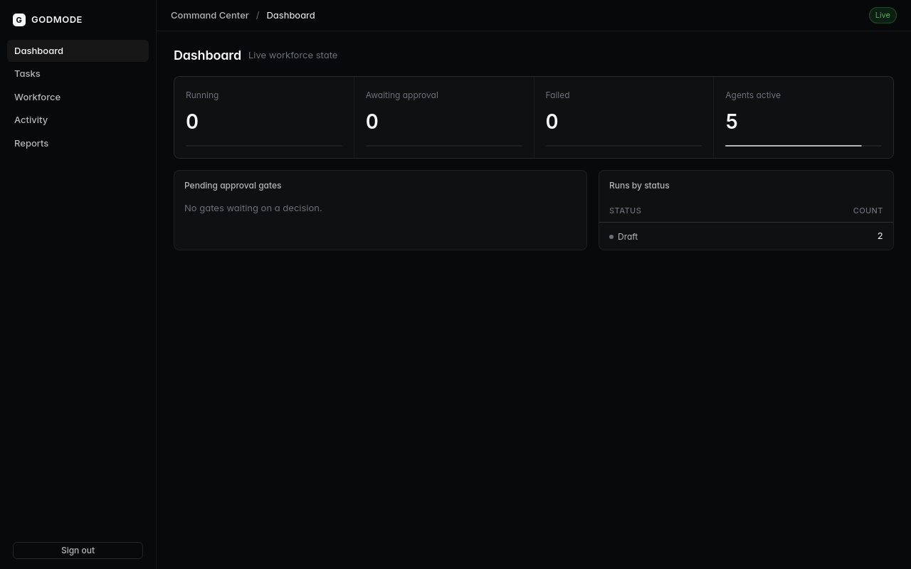
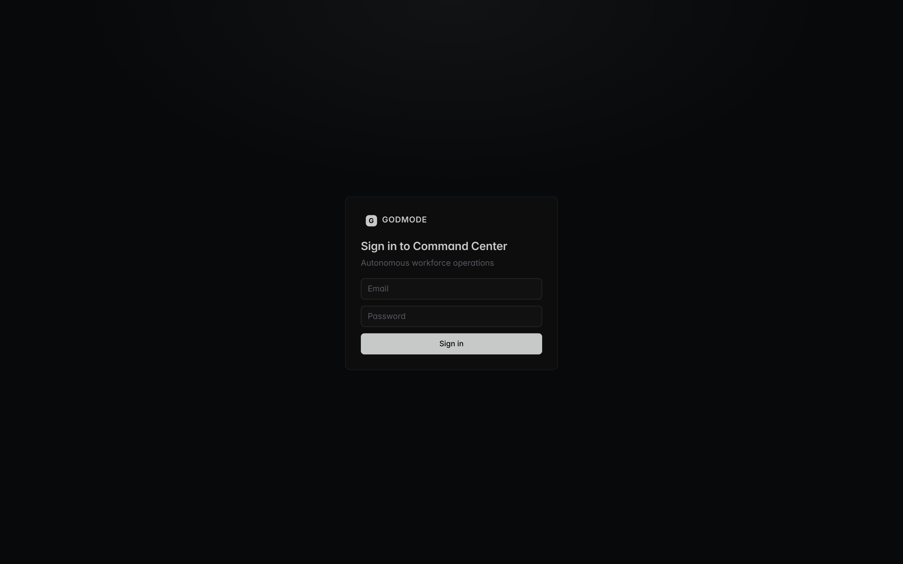
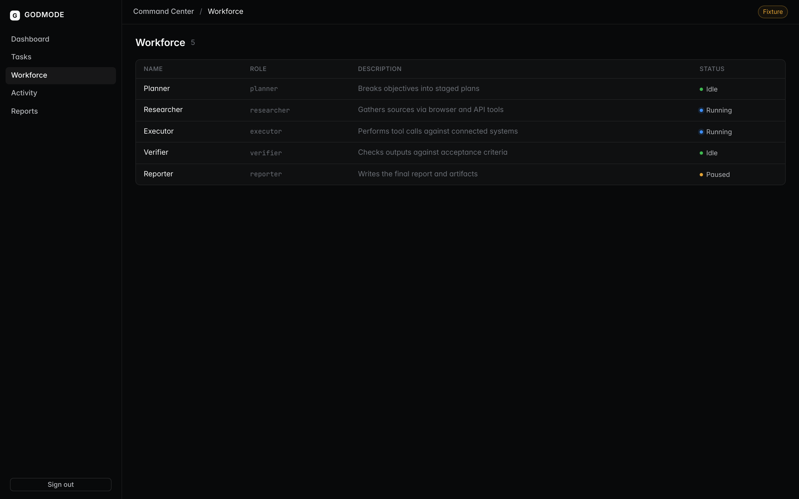
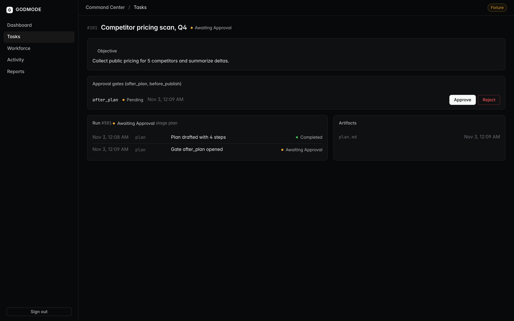
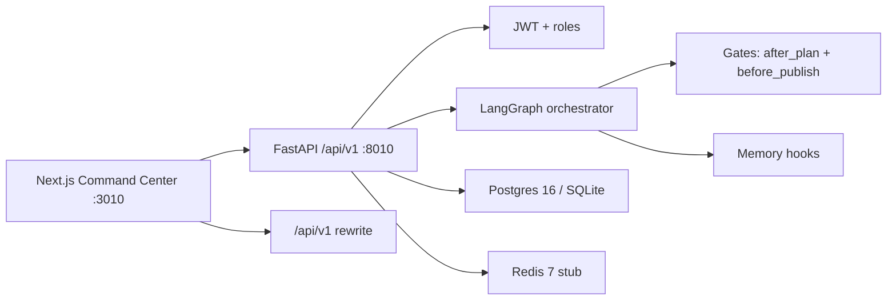

# ALLinONE


[](IMPLEMENTATION_STATUS.md)
[](#tests)
[](#tests)
[](#architecture)
[](#architecture)
[](#architecture)
[](#architecture)
[](#architecture)
[](#quick-start)
[](#)

<p align="center">
  
</p>

🧠 **ALLinONE** is an autonomous digital workforce command center. Describe a business objective in plain language. A team of AI agents plans, researches, executes, verifies, and reports, with human approval gates and a full audit trail.

This repository is the runnable MVP. Out of the box it uses a mock LLM (`GODMODE_MOCK_LLM=1`), so no paid model keys are required for local demo.

## ✨ Features

1. **Command Center UI** (Next.js + Motion) with Live / Fixture source chip, dashboard, workforce, tasks, and readable approval gates.
2. **Natural-language tasks** with create-to-start flow and live DTO-backed task detail.
3. **Multi-agent orchestration** via LangGraph: plan, research, execute, verify, report.
4. **Two human gates**: after plan, and before publish. Approve or reject with audit.
5. **JWT auth** and roles: admin, operator, viewer.
6. **Workforce management**: seeded agent definitions (slug, role prompt, tools allowlist, status).
7. **Audit log**, persistent memory hooks, and report / dashboard summary analytics.
8. **Integrations stub**: authenticated `GET /api/v1/integrations` returns `[]` (no live outbound yet).

## 📸 Screenshots

| Login | Tasks (Live) |
|---|---|
|  |  |

| Workforce | Task detail |
|---|---|
|  |  |

## 🏗️ Architecture



| Layer | Choice |
|---|---|
| Web | Next.js 14 App Router, React 18, TypeScript, Motion |
| API | FastAPI, SQLAlchemy 2, Pydantic |
| Orchestration | LangGraph two-gate graph; mock LLM for local |
| Data | PostgreSQL 16 + Redis 7 in Compose; SQLite for smoke and tests |
| Auth | JWT access + refresh; seed admin via `GODMODE_ADMIN_*` (`SEED_*` alias) |
| Runtime | Docker Compose (ports 8010 / 3010) |

Source of truth for contracts: [docs/ARCHITECTURE.md](docs/ARCHITECTURE.md). Honesty board: [IMPLEMENTATION_STATUS.md](IMPLEMENTATION_STATUS.md). Ops notes: [RUNBOOK.md](RUNBOOK.md), [handoffs/DOCKER_STATUS.md](handoffs/DOCKER_STATUS.md).

## 🚀 Quick start

### Docker (recommended)

```bash
cp .env.example .env
# Set JWT_SECRET to >=32 chars, e.g. openssl rand -hex 32
# Set POSTGRES_PASSWORD
docker compose up --build
```

- Web: http://localhost:3010
- API: http://localhost:8010 (`/docs` for OpenAPI)
- Health: `GET /health` and `GET /ready`

#### Host without iptables

If bridge DNS fails because dockerd runs with `--iptables=false`, use the host-network override. Ports stay 8010 / 3010:

```bash
sudo dockerd --iptables=false > /tmp/dockerd.log 2>&1 &
docker compose -f docker-compose.yml -f docker-compose.box.yml up --build -d
```

Stock bridge Compose is unverified on hosts missing iptables.

### No Docker

Python 3.12+ and Node 20+:

```bash
./scripts/dev-local.sh
```

API on 8010 (SQLite + mock LLM), web on 3010.

### Smoke test

```bash
scripts/smoke-local.sh
```

Reuses an API already on 8010, otherwise starts one. Checks health, ready, login, and dashboard summary.

## 🔑 Demo login

| Email | Password | Role |
|---|---|---|
| admin@godmode.local | godmode123 | admin |

Override with `GODMODE_ADMIN_EMAIL` / `GODMODE_ADMIN_PASSWORD` (or `SEED_ADMIN_*` alias) before any shared deploy.

## 🎯 Try the happy path

1. Sign in with the demo admin.
2. Open Tasks, create a task, then Start run.
3. When a gate appears, Approve or Reject (After plan / Before publish).
4. Check dashboard summary, audit, and workforce.

## 🧪 Tests

API (from repo root):

```bash
python3 -m venv .venv && . .venv/bin/activate
pip install -r apps/api/requirements.txt
GODMODE_MOCK_LLM=1 .venv/bin/pytest apps/api/tests -q
```

Expect **22 passed**.

Web:

```bash
cd apps/web
npm install
npm test -- --run
```

Expect **13/13**.

## 📁 Repository layout

```
apps/
  api/          FastAPI, ORM, LangGraph orchestrator, pytest
  web/          Next.js Command Center + vitest
packages/
  shared/       Shared TypeScript types
infra/
  migrations/   SQL schema (001-003)
docs/           Architecture, ADRs mirror, screenshots
handoffs/       Status notes (Docker, integrations)
scripts/        dev-local.sh, smoke-local.sh
docker-compose.yml
docker-compose.box.yml
```

## 📊 Status and caveats

Board: **GREEN with caveats** (see [IMPLEMENTATION_STATUS.md](IMPLEMENTATION_STATUS.md)).

| Item | State |
|---|---|
| API pytest | 22 passed |
| Web vitest | 13/13 |
| Compose E2E (box host-network) | Proven |
| Stock bridge Compose | Unverified without iptables |
| Mock LLM | Default for local; real keys optional later |
| Integrations | Stub list only; no live outbound tools |
| Production deploy | Not done; requires explicit owner approval |

## 🛡️ Security

No secrets are committed. Copy `.env.example` to `.env`. `apps/web/.env.local` is gitignored. Default JWT and demo passwords are for local use only.

## 📜 License

Private project repository. All rights reserved unless otherwise stated by the owner.
